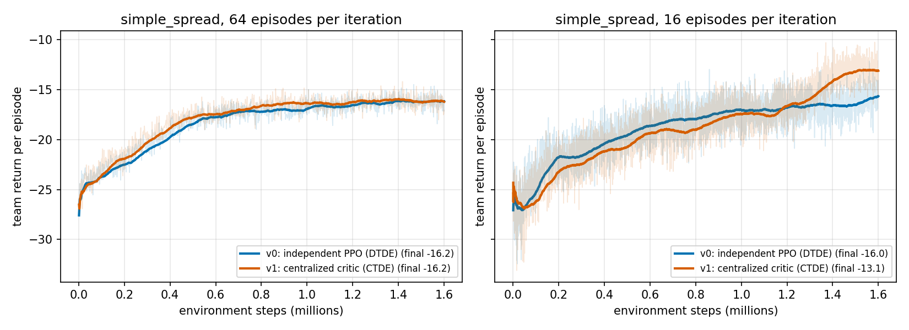
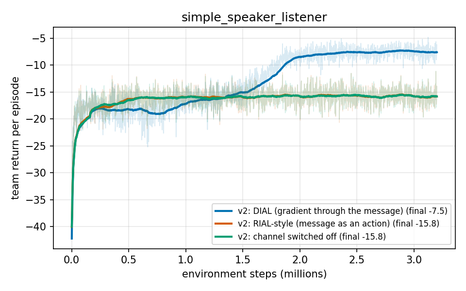
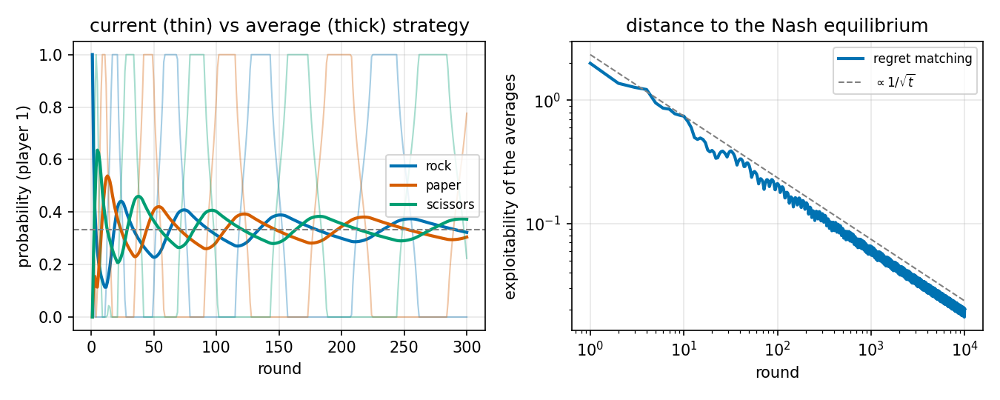

# Multi-Agent-RL

A short tutorial on cooperative multi-agent reinforcement learning with the simple particle environments (MPE) of PettingZoo. One small example per setting from the lecture: independent learners (DTDE, version0), centralized training with decentralized execution through a centralized critic (CTDE, version1), and agents that learn to communicate (version2). version3 is a detour to the game-theory part: regret matching in rock–paper–scissors.

---

## Theory

Please note that the theory corresponding to the codes is hosted on this [page](https://parag1604.github.io/notes/Reinforcement-Learning/Multi-Agent-Reinforcement-Learning). The code follows its notation: agent $i$ acts with a decentralized policy $\pi_i(a_i \mid o_i)$ on its own observation $o_i$, all agents share the team reward $r_t$, and a critic is either local, $V_i(o_i)$, or centralized, $V(s)$. The single-agent algorithm underneath everything is PPO, from the [Policy-Gradients](https://github.com/parag1604/Policy-Gradients) repository.

## Python Environment Setup

Python >= 3.10, then:

```bash
pip install -r requirements.txt
```

The MPE tasks used to live in `pettingzoo.mpe`; they are now the separate package `mpe2` (Farama), with the same parallel API (`simple_spread_v3`, `simple_speaker_listener_v4`).

## Running

`common.py` holds the shared pieces: a batch of environment copies stepped together, the rollout, GAE($\lambda$) and the PPO update. Every PPO iteration plays one 25-step episode in each of 64 environment copies (1600 environment steps), then runs 10 epochs of PPO with 2 minibatches (Adam, learning rate $7\times10^{-4}$, $\gamma = 0.99$, $\lambda = 0.95$, clip 0.2, entropy bonus 0.01, two hidden layers of 64 tanh units). The fixed-length episodes end at step 25; the last step is treated as terminal. Each script has `--help` and `--iters` and saves its learning curve to `runs/`; `python plot_results.py` draws the figures in `static/` and prints the numbers quoted below. The runs were on the CPU of a laptop, several at once, and took 14 to 20 minutes each (rough wall-clock times).

The team return is the sum of the 25 team rewards of an episode; the curves show the mean over the training episodes of each iteration (the stochastic policies as they are being trained), with a moving average over 5% of the run. "Final" is the mean over the last 10% of the iterations.

All results at a glance:

| Task | Version | Environment steps | Final team return |
|---|---|---|---|
| simple_spread (3 agents), 64 episodes per iteration | v0: independent PPO (DTDE) | 1.6M | −16.2 |
| | v1: centralized critic (CTDE) | 1.6M | −16.2 |
| simple_spread (3 agents), 16 episodes per iteration | v0: independent PPO (DTDE) | 1.6M | −16.0 |
| | v1: centralized critic (CTDE) | 1.6M | −13.1 |
| simple_speaker_listener | v2: DIAL (gradient through the message) | 3.2M | −7.5 (−7.6 with discrete messages) |
| | v2: RIAL-style (message as an action) | 3.2M | −15.8 |
| | v2: channel switched off | 3.2M | −15.8 |
| rock–paper–scissors | v3: regret matching | 10 000 rounds | exploitability 0.020 |

For scale: the untrained, near-uniform policies score about −27 on simple_spread and about −42 on simple_speaker_listener.

### version0: independent learners (DTDE) on simple_spread

```bash
python version0.py                                   # 64 episodes per iteration, 1000 iterations
python version0.py --n-envs 16 --iters 4000 --log runs/v0_ippo_16envs.json
```

Three agents must spread out to cover three landmarks. Each agent's environment reward is minus the sum, over landmarks, of the distance to the closest agent, plus a penalty for collisions; the team reward $r_t$ is their mean, and every agent is trained on it. Every agent $i$ has its own actor $\pi_i(a_i \mid o_i)$ and its own critic $V_i(o_i)$, sees only its own observation (its position and velocity, the landmarks and the other agents relative to itself), and runs ordinary PPO as if the other agents were part of the environment. Nothing is shared, not even parameters.

### version1: centralized critic (CTDE, MAPPO-style) on simple_spread

```bash
python version1.py
python version1.py --n-envs 16 --iters 4000 --log runs/v1_mappo_16envs.json
```

New: one critic $V(s)$ for the whole team, fed with the global state $s$ (here the concatenation of all observations), instead of a local $V_i(o_i)$ per agent. All agents use the same advantage

$$
\hat A_t = \sum_{l \ge 0} (\gamma\lambda)^l \delta_{t+l}, \qquad \delta_t = r_t + \gamma V(s_{t+1}) - V(s_t).
$$

The actors are unchanged and still act on their own observations, so execution stays decentralized; the global state is needed only during training.



Result: with 64 episodes per PPO iteration the two curves are almost on top of each other and both end at −16.2; with 16 episodes per iteration the centralized critic ends ahead (−13.1 vs −16.0), but it trailed for most of the run and pulled ahead only in the last fifth, so treat that gap with caution. This is the lecture's point about independent PPO: on an easy cooperative task, independent learners with a good on-policy algorithm are a strong baseline, and a centralized critic is no guaranteed win; it mostly matters when the local critics' targets are noisy.

### version2: learning to communicate on simple_speaker_listener

```bash
python version2.py                    # DIAL
python version2.py --channel rial     # message as the speaker's action
python version2.py --channel off      # channel switched off
```

A task where talking is necessary. Of three coloured landmarks, the listener must reach the goal, but only the speaker knows which one it is, and the speaker cannot move. Both get the team reward, minus the squared distance from the listener to the goal. The speaker's only influence is a 3-dimensional message that the listener sees in its observation. Each agent still has its own actor and local critic and runs PPO, as in version0; the settings differ in how the speaker learns what to say:

- **DIAL** (Foerster et al., 2016). The speaker's network outputs $z = g(\text{goal colour}) \in \mathbb{R}^3$, and during training the message is DIAL's noisy "discretize/regularize unit", $m = \sigma(z + \sigma_{\text{DRU}}\,\epsilon)$ with $\epsilon \sim \mathcal{N}(0, I)$ and $\sigma_{\text{DRU}} = 2$, passed straight into the listener's network. The listener's PPO loss is then differentiable in the speaker's parameters, and its gradient flows **through the message** into the speaker. At execution the message is three bits, $m = \mathbb{1}[z > 0]$.
- **RIAL-style.** The message is one of three symbols, chosen by the speaker's own PPO policy from the team reward alone; no gradient crosses between the agents.
- **Off.** The listener's message entries are set to zero; the listener can only hedge between the landmarks.



Result: with DIAL the speaker settles on a different code for each goal colour (bits 011 for red, 001 for green, 110 for blue), and the team return rises from the no-communication level of about −16 to −7.5 (−7.6 with discrete bits at execution, over 320 episodes). The protocol takes time to appear: DIAL stays at the no-communication level for the first 1.5M steps, then climbs. With the message as an ordinary action (RIAL-style) no protocol emerged in 3.2M steps: the speaker's symbol probabilities were only weakly tied to the goal colour (0.66, 0.58 and 0.49 on the "diagonal") and the listener gained nothing from the channel, ending exactly where the switched-off channel ends (−15.8). This is the gap DIAL was designed to close: through the message, the speaker gets a direct gradient on how its message changed the listener's choice, while a RIAL speaker must discover the same thing from a team reward that, as long as the listener ignores it, does not depend on what it says.

Two things that did not work first and were changed: a Gumbel-softmax relaxation of a single one-hot symbol made the speaker collapse to the same symbol for every colour (once the relaxed symbol saturates, the gradient through it vanishes), which the independent noisy bits of DIAL's unit avoid; and with 16 episodes per iteration even a listener given the correct goal for free did not learn to use it in 0.8M steps, hence 64 episodes per iteration and 10 PPO epochs everywhere.

### version3: regret matching in rock–paper–scissors

```bash
python version3.py
```

A detour to the lecture's game-theory part. Two players repeatedly play rock–paper–scissors. Each keeps, for every action $a$, its cumulative regret $\mathrm{Reg}_t(a) = \sum_{k \le t} \big(u_k(a) - u_k(a_k)\big)$, how much better always playing $a$ would have done, and plays each action with probability proportional to its positive regret (Hart & Mas-Colell, 2000):

$$
\pi_{t+1}(a) = \frac{\max(\mathrm{Reg}_t(a), 0)}{\sum_b \max(\mathrm{Reg}_t(b), 0)} .
$$

Both players start off equilibrium, and the run uses expected payoffs, so it is deterministic. The current strategies keep cycling between pure actions, but the average strategies converge to the mixed Nash equilibrium $(1/3, 1/3, 1/3)$: after $10^4$ rounds player 1's average is $(0.337, 0.336, 0.327)$, and the exploitability of the averages (what both players together could gain by best-responding, 0 exactly at a Nash equilibrium) falls from 0.21 after 100 rounds to 0.064 after 1000 and 0.020 after $10^4$, roughly like $1/\sqrt{t}$. The lecture shows the same behaviour for fictitious play.



## References

- J. Foerster, Y. Assael, N. de Freitas and S. Whiteson. *Learning to Communicate with Deep Multi-Agent Reinforcement Learning.* NeurIPS 2016. [arXiv:1605.06676](https://arxiv.org/abs/1605.06676)
- C. Yu, A. Velu, E. Vinitsky, J. Gao, Y. Wang, A. Bayen and Y. Wu. *The Surprising Effectiveness of PPO in Cooperative Multi-Agent Games.* NeurIPS 2022 Datasets and Benchmarks. [arXiv:2103.01955](https://arxiv.org/abs/2103.01955)
- C. Schroeder de Witt, T. Gupta, D. Makoviichuk, V. Makoviychuk, P. Torr, M. Sun and S. Whiteson. *Is Independent Learning All You Need in the StarCraft Multi-Agent Challenge?* 2020. [arXiv:2011.09533](https://arxiv.org/abs/2011.09533)
- R. Lowe, Y. Wu, A. Tamar, J. Harb, P. Abbeel and I. Mordatch. *Multi-Agent Actor-Critic for Mixed Cooperative-Competitive Environments.* NeurIPS 2017 (the particle environments). [arXiv:1706.02275](https://arxiv.org/abs/1706.02275)
- S. Hart and A. Mas-Colell. *A Simple Adaptive Procedure Leading to Correlated Equilibrium.* Econometrica 68(5), 2000. [doi:10.1111/1468-0262.00153](https://doi.org/10.1111/1468-0262.00153)
